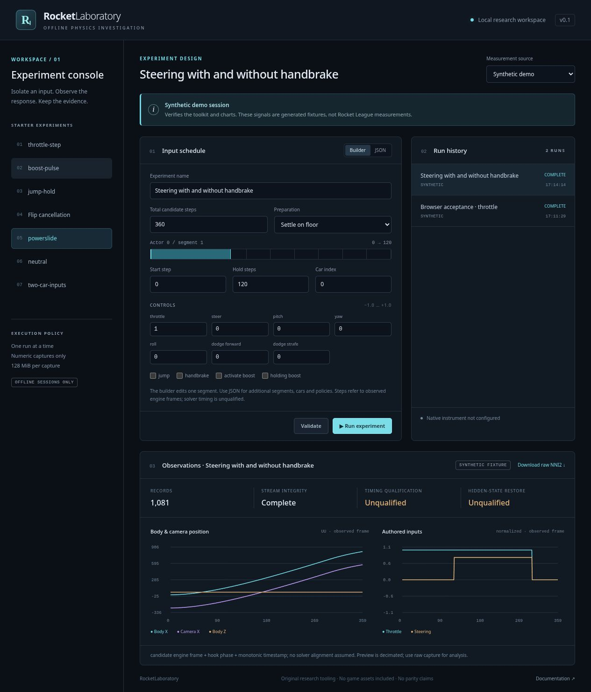

# RocketLaboratory

An independent toolkit for investigating **offline Rocket League behavior** with scripted inputs and compact numeric telemetry. A browser experiment editor, CLI and MCP server share the same execution layer.

RocketLaboratory contains original tooling extracted from the NinjaBladeNoodle research project. It contains **no game assets, game code, private recordings, measured player profiles, or third-party runtime binaries**. It does not depend on NinjaBladeNoodle, Godot or Blender. The provisional project name does not imply trademark clearance or affiliation with Psyonix, Epic Games, RLBot or BakkesMod.



## Try it without Rocket League

Python **3.12 or newer** is the only runtime requirement for the toolkit. The core has no third-party Python dependencies.

```sh
git clone git@github.com:dougwhite/RocketLaboratory.git
cd RocketLaboratory
python3 -m venv .venv
. .venv/bin/activate
python -m pip install .
rocketlab serve
```

Open **http://127.0.0.1:8890**. Choose a starter experiment, edit its inputs, validate, run, and inspect body/camera plots. The default backend produces **synthetic transport fixtures**, not a Rocket League physics simulation. Results are stored outside the repository in the platform user-data directory; `--workspace PATH` overrides it.

Windows: create the environment with `py -3 -m venv .venv`, activate with `.venv\Scripts\Activate.ps1`, then use the same `python -m pip install .` and `rocketlab serve` commands.

## CLI and automation

```sh
rocketlab doctor
rocketlab example throttle-step experiment.json
rocketlab validate experiment.json
rocketlab run experiment.json --backend demo
rocketlab jobs
rocketlab result JOB_ID
rocketlab campaign examples/repeatability-campaign.json --backend demo
rocketlab inspect /path/to/capture.nni
rocketlab export /path/to/capture.nni /path/to/capture.jsonl
rocketlab compare /path/to/first.nni /path/to/second.nni
```

Global `--workspace` and `--bridge-dir` options go **before** the command. `run` waits for completion and returns a nonzero exit code on failure/cancellation. Campaigns run serially and stop at the first failed run. They do not automatically renew native sessions.

The editor supports a simple first-segment builder plus a full JSON editor for multiple cars and segments. Neutral gaps, numeric limits and nonoverlapping input schedules are enforced. See [experiment format](docs/EXPERIMENTS.md) and the packaged [JSON Schema](src/rocketlaboratory/experiment.schema.json).

## Run against Rocket League

The native backend attaches to **one already-running offline session** with the original SDK plugin loaded through the official BakkesMod loader. It does not launch the game, install a loader, bypass compatibility checks or change anti-cheat files.

1. Install your own Rocket League copy and a currently supported official offline-compatible mod setup.
2. Build `rocketlab_instrument.dll` on **Windows x64 with MSVC**, using the externally fetched BakkesMod SDK. A Linux machine can host the UI and drive the file bridge under Proton, but cannot compile this MSVC-ABI plugin with MinGW.
3. Install the locally built plugin through BakkesMod. Create/locate its `data/noodle-instrument` directory.
4. Arm a short-lived bridge, then reload the plugin in BakkesMod:

   ```sh
   rocketlab --bridge-dir "/path/to/bakkesmod/data/noodle-instrument" arm
   ```

5. In a supported offline local session, verify attachment and run:

   ```sh
   rocketlab --bridge-dir "/path/to/bakkesmod/data/noodle-instrument" native actors
   rocketlab --bridge-dir "/path/to/bakkesmod/data/noodle-instrument" run experiment.json --backend native
   rocketlab --bridge-dir "/path/to/bakkesmod/data/noodle-instrument" serve
   ```

Native attachment is opt-in. A session expires after at most five minutes. Reloading is required after rearming. Existing captures are never interrupted by a new experiment. The instrument enforces its own offline gate and watchdog in addition to host-side limits.

Read [installation and platform support](docs/INSTALLATION.md), [native protocol](docs/NATIVE.md), and [licensing boundaries](THIRD_PARTY.md) before native use. Native setup remains sensitive to Rocket League/BakkesMod versions; v0.1 packaging tests are not a fresh game compatibility certification. The standalone DLL was built with MSVC and the 69 Python tests plus portable C++ checks passed on Linux and Windows; see [validation evidence](docs/VALIDATION.json). No native game pilot was run for this extraction.

## MCP

```json
{
  "mcpServers": {
    "rocketlaboratory": {
      "command": "/absolute/path/to/.venv/bin/rocketlab",
      "args": ["--workspace", "/absolute/path/to/private-results", "mcp"]
    }
  }
}
```

For native use, add `"--bridge-dir", "/path/to/bakkesmod/data/noodle-instrument"` before `"mcp"`. The native plugin must already be armed and reloaded. Tools cover capability inspection, starter definitions, validation, run submission, history, status, result inspection and cancellation. See [MCP and HTTP interfaces](docs/INTERFACES.md). There is no arbitrary console/shell tool.

## What is measured, and what is not established

The native stream preserves float32/int32 values from public SDK getters: requested and observed controller inputs; rigid-body tuples and their separate sources; wheel/contact/suspension observations; jump/mechanic/configuration state; camera transforms/settings/targets; world values; pad observations and events where exposed. Every record carries its sequence, hook phase, capture-local actor ID, candidate engine frame and monotonic timestamp. CRCs detect damaged records; absent values remain absent.

**Solver-phase timing, camera/body synchronization and full hidden-state restoration remain unqualified.** A scheduler reaching Done is not proof that inputs were consumed correctly. A complete stream is not proof of physics parity. Reports never mark exact acceptance eligible. Captured camera settings are observations; the toolkit currently cannot author camera settings or manual-swivel inputs. Native scripted preparation supports settled floor and one guarded fixed-pose recipe, not arbitrary suspension/jump/contact checkpoints. Multi-car tapes require existing cars; the toolkit does not spawn them.

See [investigation methodology and capability ledger](docs/METHODOLOGY.md). This release provides reusable infrastructure and preserves those limitations instead of treating approximate measurements as exact laws.

## Dependencies and development

```sh
rocketlab deps list
rocketlab deps fetch bakkesmod-sdk
rocketlab deps fetch rlbot-python-source
python -m unittest discover -s tests -v
cmake -S native -B build/native
cmake --build build/native
ctest --test-dir build/native --output-on-failure
python scripts/check-public-tree.py
```

Dependencies are fetched by pinned revision and verified SHA-256 into an external cache; notices stay with the upstream tree. The RLBot Python source is an optional integration dependency, **not an implemented v0.1 launcher/backend**. RLBot server/Bridge.dll, the BakkesMod loader, Rocket League and Proton are user-installed runtimes and are not bundled. The Windows plugin build script fetches the pinned SDK automatically when no explicit SDK path is supplied.

License: [MIT](LICENSE) for our original code, with original contributor notices retained. External components retain their own terms. Public-source auditing is allowlisted; CI does not publish SDK-linked DLLs. See [CONTRIBUTING.md](CONTRIBUTING.md) and [AGENTS.md](AGENTS.md).
